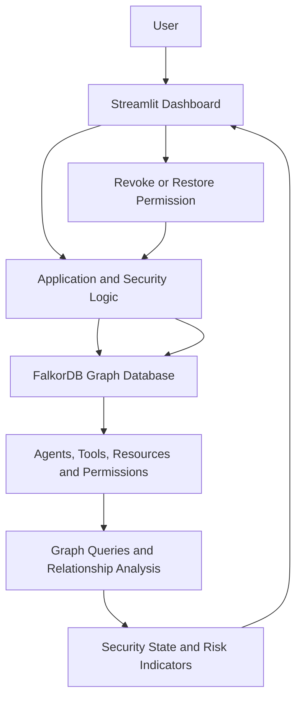

# 🛡️ AgentShield Graph
### Beyond Chatbots: A Graph-Powered Security Investigator for AI Agents

**Investigate connected access risks. Trace relationships. Verify remediation.**

AI agents can interact with tools, retrieve information, and perform tasks with increasing autonomy. But as their capabilities grow, understanding what they can access—and how a risk can travel through connected systems—becomes increasingly important.

**AgentShield Graph** explores how graph-powered security investigation can help make AI-agent permissions, risky access paths, and remediation outcomes easier to understand.

🔴 **Live Demo:** [Launch AgentShield Graph](https://agentshield-graph-f96r95tkrflj3gtp2fbyyx.streamlit.app/)

💻 **GitHub Repository:** [AishwaryaKanchu/agentshield-graph](https://github.com/AishwaryaKanchu/agentshield-graph)


---

## 🚨 The Problem: Security Risks Don't Exist in Isolation

Imagine an AI agent that can call a database tool, which in turn can access a protected resource. A permission associated with one component can affect the security of the wider system.

Looking at individual agents, tools, and permissions separately may hide the connections that make a risky access path possible.

Security investigators need to understand more than whether a single permission exists. They need to investigate how entities are connected, which relationships contribute to a potential risk, and whether changing a permission actually changes the graph's security state.

**What if a security investigation could follow the relationships themselves?**

## 💡 The Idea: Turn Security Context Into a Graph

AgentShield Graph uses **FalkorDB** to represent connected security entities and permission relationships.

Instead of treating permissions as isolated records, the project explores how graph relationships can support access-path investigation and permission remediation.

A simplified conceptual example:

```text
AI Agent
   |
   | has access to
   v
Tool
   |
   | can access
   v
Protected Resource
```

The relationships between these entities provide the context for investigating potentially risky access.

FalkorDB is intended to serve as the graph data layer behind the security workflow, rather than merely supplying decorative graph visualization.

## ✨ Key Features

### 1. Graph-Based Security Investigation

Represent agents, tools, resources, and permission relationships in a connected graph. Explore how relationships can contribute to a potentially risky access path.

### 2. Permission Revocation and Threat Containment

Revoke a synthetic permission to demonstrate how changing access relationships affects the security state. The demo includes the permission `perm-002`, associated with `CustomerSupportBot` and `SQLQueryTool`.

### 3. Permission Restoration and Retesting

Restore the synthetic permission and inspect the resulting state. This allows the demonstration to test both the containment operation and the effect of restoring access.

### 4. Security Status Monitoring

Inspect permission states and the application's risky-path indicators before and after remediation.

### 5. Interactive Streamlit Dashboard

Explore the security scenario through a web dashboard that connects the graph-backed application logic with its security controls.

### 6. AI-Assisted Investigation

The project has an intended LLM-powered investigation path using Google Gemini, alongside deterministic fallback behavior. Live Gemini functionality depends on valid configuration and successful requests; the fallback should not be mistaken for a live LLM response.

> **Scope:** AgentShield Graph is a prototype using synthetic demonstration data. Its findings should be treated as investigation signals, not proof that every real-world vulnerability or attack path can be detected.

## 🏗️ Architecture



### Architecture overview

- **Streamlit** provides the user interface.
- **Python** implements application behavior and security operations.
- **FalkorDB** stores the connected graph data.
- **Graph queries and relationship analysis** support the application's security workflow.
- **Permission remediation** changes the synthetic security state so the application can inspect the result.

## 🧠 Graph Data Model

The demonstration uses connected security entities.

| Entity | Purpose |
|---|---|
| Agent | Represents an AI agent, such as `CustomerSupportBot` |
| Tool | Represents a tool, such as `SQLQueryTool` |
| Resource | Represents a resource involved in the security scenario |
| Permission | Represents access or authorization information |
| Security event | Represents a security-related event, if stored by the implementation |

### Relationships

Relationships connect entities according to the access and permission model used by the application. These connections allow the application to inspect how a permission change affects the security graph.


##  🔎 Cypher Queries and Graph Algorithms

AgentShield Graph uses FalkorDB to represent connected AI agents, tools, permissions, resources, and security-related information. Cypher queries allow the application to inspect relationships and support permission-management workflows.

### 1. Retrieve agent–tool relationships

```cypher
MATCH (a:Agent)-[p:CAN_CALL]->(t:Tool)
RETURN a.name, p.status, t.name
```

**Purpose:** Retrieves agents, their connected tools, and the status of each `CAN_CALL` relationship.

**How the application uses it:** Provides information about agent–tool connections and permission status.

### 2. Graph initialization

Document the actual initialization code or Cypher statements used to create the synthetic graph, nodes, relationships, and initial permission states.

### 3. Security-path analysis

Document the actual query or algorithm used to identify risky relationships or access paths. Explain the conditions that cause a path to be classified as risky.

### 4. Permission revocation

Document the actual query or application logic used to revoke a selected permission and update the graph state.

### 5. Permission restoration

Document the actual query or application logic used to restore a previously revoked permission.

### 6. Post-action verification

Document how the application checks the updated permission state and recalculates or verifies its security indicators after a change.


## 🔄 Demonstration Workflow

The live application can be used to demonstrate the following sequence:

1. **Inspect:** Open the dashboard and inspect the synthetic security graph.
2. **Identify:** Examine the permission and the associated risky-path indicator.
3. **Contain:** Revoke `perm-002`.
4. **Verify:** Check the resulting permission state and active risky-path indicator.
5. **Restore:** Restore the synthetic permission.
6. **Retest:** Inspect the graph state again and repeat containment.

## 🧪 Example Security Scenario

The synthetic demo includes the permission `perm-002`, associated with `CustomerSupportBot` and `SQLQueryTool`.

| Operation | What to inspect |
|---|---|
| Initial state | Current permission status and graph relationships |
| Revoke permission | Whether the permission becomes revoked |
| Verify containment | Whether the application's risky-path indicator updates |
| Restore permission | Whether the permission becomes active again |
| Revoke again | Whether the application returns to the contained state |

The exact path counts depend on the implemented graph logic and current graph state. Report observed values from the running application rather than assuming fixed numbers.

## 🧰 Technology Stack

- **Python** — Application and security logic
- **FalkorDB** — Graph database
- **Cypher** — Graph queries, where used by the implementation
- **Streamlit** — Interactive dashboard
- **Git and GitHub** — Version control and source hosting
- **Streamlit Community Cloud** — Live deployment
- **Google Gemini** — Optional LLM integration, subject to configuration and successful requests

## 🚀 Getting Started

### Prerequisites

- Git
- Python compatible with the project's dependencies
- Access to a FalkorDB instance
- The dependencies listed in `requirements.txt`

### 1. Clone the repository

```bash
git clone https://github.com/AishwaryaKanchu/agentshield-graph.git
cd agentshield-graph
```

### 2. Create and activate a virtual environment

**Windows PowerShell**

```powershell
python -m venv .venv
.venv\Scripts\Activate.ps1
```

**macOS / Linux**

```bash
python3 -m venv .venv
source .venv/bin/activate
```

### 3. Install dependencies

```bash
pip install -r requirements.txt
```

### 4. Configure FalkorDB

Configure the connection values expected by the application. For the current configuration, these include:

```text
FALKORDB_HOST=your-falkordb-host
FALKORDB_PORT=your-falkordb-port
FALKORDB_GRAPH=agentshield
FALKORDB_USERNAME=your-username
FALKORDB_PASSWORD=your-password
FALKORDB_TLS=true
```

Use the TLS setting and connection parameters appropriate for your database deployment. For Streamlit Community Cloud, configure secrets through the app's settings.

**Never commit database credentials, API keys, or passwords to the repository.**

### 5. Run the application

```bash
streamlit run app.py
```

Open the local URL printed by Streamlit.

For the exact supported setup, consult the project's dependency file and source configuration.

## 🔐 Security Considerations

- Use synthetic or otherwise authorized data in demonstrations.
- Keep credentials and API keys out of source control.
- Apply least-privilege access to database accounts.
- Use encrypted database connections where supported and configured.
- Treat risk indicators as decision-support signals.
- Verify remediation by checking the resulting graph state.
- Test changes in a controlled environment before adapting them to real systems.

## 🎥 Demo Video

**Public YouTube demo:** https://www.youtube.com/watch?v=WQr0K2me5Gw

## 🤖 AI Assistance Disclosure

AI coding assistants were used to assist with development, debugging, and documentation.

## 🗺️ Future Improvements

Potential directions for future development include:

- More advanced graph-based risk scoring
- Explainable multi-hop access-path analysis
- Detailed audit history for permission changes
- More comprehensive security event monitoring
- Automated regression tests for remediation workflows
- Additional synthetic security scenarios
- Clearer visualization of affected agents and resources

## 📚 What I Learned

### Relationships can drive security reasoning

A graph becomes valuable when its relationships influence what the application can investigate, rather than serving only as a visual representation.

### AI needs verifiable context

An LLM can help explain an investigation, but its output should be distinguished from findings supported by the graph.

### Remediation requires verification

A permission change is only the first step. Inspecting the updated state helps establish whether the expected outcome occurred.

### Integration requires end-to-end testing

A configured service is not necessarily a working service. Database connectivity, LLM requests, error handling, and fallback behavior need to be verified independently.

### Documentation is part of engineering

A reproducible project needs understandable graph models, accurate queries, setup instructions, and a demonstration that others can follow.

## 👩‍💻 Project Information

**Project:** AgentShield Graph  
**Developers:** Aishwarya Kanchu 
               Kunduru Bhavitha
               Laxmi Sathwika Chethi


**Repository:** [AishwaryaKanchu/agentshield-graph](https://github.com/AishwaryaKanchu/agentshield-graph)  
**Live Demo:** [AgentShield Graph on Streamlit](https://agentshield-graph-f96r95tkrflj3gtp2fbyyx.streamlit.app/)

---

*Making AI-agent security relationships easier to investigate, permissions easier to control, and remediation easier to verify.* 🛡️

#FalkorDB #GraphHacks #AI #Cybersecurity #GraphDatabases #BuildInPublic
